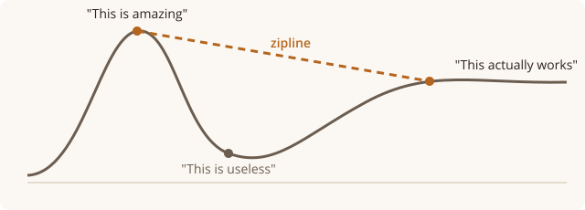

<p align="center"></p>

# zipline

**From "this is amazing" to "this actually works", without the crash in between.**

Most people who start working with an assistant go through the same curve: a burst of
excitement, then a hard drop when it confidently gets things wrong, goes round in circles on
the twentieth version of the same thing, or can't make what they had in mind. Many give up
there. The ones who stick with it get to a steady, useful place on the other side.

What gets them there isn't a cleverer assistant. It's working habits: agree how you'll check
the result before the first try, stop after a few tries and step back, never let it send,
delete or publish on its own, and keep a record. zipline is those habits, written down for
[Claude Code](https://claude.com/claude-code) and backed by safeguards that run whether the
assistant remembers them or not.

**Early days. It works and we're refining it.**

## Who sets it up, and who uses it

Usually not the same person. A friend who runs a small business wants spreadsheets, emails
and a logo they can actually edit, instead of PDFs from a phone app that nobody can change.
They have no idea what a repository is, and they don't need to: someone technical sets zipline
up on their computer once, and from then on they open it and say what they need.

zipline is for that someone: a technical owner, or the one technical person a business, a
team or a fleet of computers relies on. You pick what kind of work it is, and it brings the
rules and tools for that kind:

| kind of work | for | it adds |
|---|---|---|
| **business** | emails, quotes, logos, menus, spreadsheets, documents | a folder for the brand, drafts and finished work; looks at a picture of every draft before describing it; says up front what it can't make |
| **code** | a repository people review | small changes with one purpose each; runs the checks before saying it works; branches and pull requests when someone reviews |
| **infrastructure** | scripts that change machines: installs, images, deployments | the assistant prepares, the person runs it with their own access; the check is written before the script; tested on a throwaway machine first |

## What it does

- **Agrees the check before the work.** What goes in, and how you'll both know it's right,
  before the first attempt. Most loops start with an input nobody looked at.
- **Says what it can't do, up front.** Not after the third disappointing try.
- **Stops going in circles.** It counts attempts. At the limit, or when you're repeating
  yourself, it stops, says back what it thinks the goal is, and asks the one question that
  would change the approach.
- **Prepares, never acts alone.** Sending, installing, deleting or overwriting your files,
  spending, publishing and changing GitHub stop until you sign: the assistant shows you
  exactly what will happen, and you type a short phrase like `email james` or `install gimp`
  to let that one action run once. "Yes" doesn't count.
- **Keeps work reviewable.** Commits too big to read stop. With a reviewer, nothing reaches
  main except through a pull request, and nothing is pushed while the project's checks fail.
- **Keeps a journal.** One plain line per thing that happened, in `journal/`, written by the
  safeguards, not the assistant.
- **Remembers what went wrong.** Lessons go in `lessons.md`, and the assistant reads them before
  similar work.

## What it looks like

Asked for a glossy 3D logo, the assistant says before trying that it builds from fonts and
shapes, and offers a clean text logo, the owner's own logo file, or a designer.

> **This is not an image generator.** It won't make AI art, so don't ask it to. Graphics are built
> the way a designer builds them: real fonts, real layouts, vector shapes (HTML/SVG → PDF), like
> the curve above. You can open, edit and reuse every file.

Asked later to email the quote to James, it stops:

> This needs your OK before it runs. It sends an email to james@example.com with
> `ready/quote.pdf` attached. To go ahead, type: **email james**

The owner types `email james`, and that one email goes.

Asked to convert a whole app to TypeScript in one go, in a repository two developers review,
it says a change that size can't be reviewed and proposes one module per commit, each on a
branch, with the type checker and the tests as the check.

## Getting started

You need [Claude Code](https://claude.com/claude-code) (a Claude subscription or your own API
key), git, and Python 3. To install Claude Code:

```
curl -fsSL https://claude.ai/install.sh | bash        # macOS, Linux
irm https://claude.ai/install.ps1 | iex                # Windows, in PowerShell
```

On Windows, install [Git for Windows](https://git-scm.com/downloads/win) (Claude Code runs
the safeguards with its Git Bash) and Python from [python.org](https://www.python.org/downloads/).
Where the steps below say `python3`, type `python` (or `py`) instead: Windows' own `python3`
only opens the Microsoft Store. The safeguards find the real one by themselves.

**1. Answer a few questions** on the [zipline page](https://drakthedude.github.io/zipline/): the
kind of work, what's happened so far with assistants, who reviews the work, your house rules.
They become a file called `workalong.md`. Your answers stay in your browser. You can skip this;
sensible defaults apply.

**2a. For a business,** zipline's folder is the workspace:

```
git clone https://github.com/DrakTheDude/zipline.git
cd zipline
(put workalong.md here)
claude
```

The first time, the assistant runs `tools/setup.py`: it checks the computer has what drafts
need, makes the folders, turns on the profile's plugins, and asks before installing anything.
Restart Claude Code once afterwards so the plugins load.

**2b. For an existing repository** (code or infrastructure), add zipline to it. From the
repository's top folder, with zipline cloned next to it:

```
cp -r ../zipline/tools ../zipline/profiles .
mkdir -p .claude && cp ../zipline/.claude/settings.json .claude/
cp ../zipline/CLAUDE.md ZIPLINE.md
echo "@ZIPLINE.md" >> CLAUDE.md
printf '/workalong.md\n/lessons.md\n/journal/\n/previews/\n/.zipline/\n/.claude/settings.local.json\n' >> .gitignore
(put workalong.md here, then)
python3 tools/setup.py
```

Your own `CLAUDE.md` stays as it is and pulls in zipline's rules with the `@ZIPLINE.md` line.
If `.claude/settings.json` already exists, merge zipline's `hooks` section into it rather than
copying over it. Commit `tools/`, `profiles/`, `ZIPLINE.md` and the settings so everyone who
clones the repository gets the same rules; `workalong.md` stays per person. If the repository
has a `claims.ini` ([claimcheck](tools/claimcheck.py)), pushes wait for it to pass.

## Where the work goes

For a business, everything stays in the folder, on that computer, and out of git, so
publishing or sharing zipline never publishes the business:

| folder or file | what's in it |
|---|---|
| `brand/` | the logo, colours, fonts, price list: what every draft reuses |
| `drafts/<job>/` | work in progress, every version a new file (`menu-v1.html`, `menu-v2.html`) |
| `ready/` | what's been approved to go out |
| `previews/` | pictures the assistant made to check drafts (safe to delete) |
| `lessons.md` | what went wrong and what fixed it |
| `workalong.md` | the settings and house rules |
| `journal/` | what happened, one line each |

**zipline doesn't back these up.** They're kept out of git on purpose, so there's no history
of them anywhere else. Make sure the computer's usual backup covers this folder.

For code and infrastructure, the work is the repository, as before. Only `workalong.md`,
`lessons.md`, `journal/` and `previews/` are zipline's, and they stay out of git.

## Keeping it up to date

In a business folder, `git pull`. The business's files aren't touched: git leaves everything in
the table above alone. Put your own rules in `workalong.md`, not in `CLAUDE.md` or `tools/`;
those are zipline's files, and changing them means an update can't come in cleanly (git will
say so rather than lose your change).

In a repository you added zipline to, pull zipline's clone and copy `tools/`, `profiles/` and
`ZIPLINE.md` again.

## How sure can you be

Some of this is enforced, and some is the assistant following instructions. The difference
matters, so here it is:

- **Enforced**, whatever the assistant decides: installing, sending, uploading, publishing,
  deleting or moving files, changing `brand/` and the settings, writing outside the folder,
  connected-service actions that send, charge or delete, commits too big to review, and changes
  to GitHub. They stop until you sign. With a reviewer, commits and pushes to main are refused
  outright, and so is any push while the project's claims fail. The settings, the profile's
  rules and the house rules are put in front of the assistant at the start of every session.
  Business drafts are counted and the limit announced. The journal can't be edited by the
  assistant.
- **Instructions**, which the assistant follows but nothing checks: agreeing the check first,
  saying what it can't do, counting attempts at code and scripts, resetting at the limit,
  asking before putting a price, date or promise in a draft, testing on a throwaway machine,
  and your own house rules.

The safeguards read what the assistant is about to do. They catch an assistant that's
confident and wrong, not one hiding what it does. [docs/safeguards.md](docs/safeguards.md)
has every detail, and [SECURITY.md](SECURITY.md) the limits.

## Builds on

Anthropic's [knowledge-work plugins](https://github.com/anthropics/knowledge-work-plugins) for
Claude Code, chosen by kind of work: **small-business** (proposals, invoices, payroll prep and
more) for business, **engineering** (code review, debugging, testing, incident response) for
code, and engineering plus **operations** (runbooks, change requests, risk assessment) for
infrastructure. `tools/setup.py` turns them on for the folder. zipline adds the working habits
around them. A new plugin is one line in a profile, and a new kind of work is one new file in
[profiles/](profiles/).

## Tested on

Ubuntu, with made-up businesses, a few real sessions, and throwaway repositories. One first
session on Windows, which found that `python3` there is only a Store shortcut. macOS
should work but hasn't been tried yet; if you try,
[CONTRIBUTING.md](CONTRIBUTING.md) says what's most useful to send.

## More

- [docs/safeguards.md](docs/safeguards.md): what stops, how signing works, the git rules, the journal
- [docs/workalong.md](docs/workalong.md): every setting in `workalong.md`, the profiles and the levels
- [profiles/](profiles/): the working rules for each kind of work
- [CLAUDE.md](CLAUDE.md): the rules every kind of work shares, in plain words
- [CONTRIBUTING.md](CONTRIBUTING.md): what helps most, and the checks to run
- [SECURITY.md](SECURITY.md): reporting a problem privately, and what this doesn't protect

## License

Apache-2.0. See [LICENSE](LICENSE). Third-party notes in [NOTICE.md](NOTICE.md).
